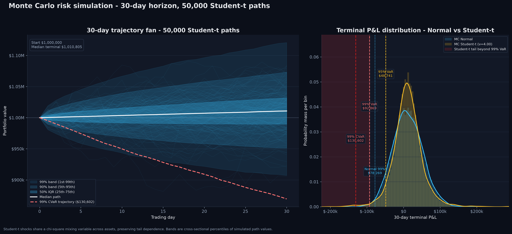

# Multi-Asset Portfolio Risk Engine & Regulatory Backtesting Framework

**Quantitative Risk Research — Model Validation Memo**
*Multi-Asset Risk Desk, New York · Version 1.0.0 · Python 3.11+*

---

## 1. Executive Summary

This library implements an end-to-end, production-style risk stack for a multi-asset
portfolio: data ingestion and integrity controls, four independent VaR/CVaR models,
a conditional filtered EWMA Student-t model, exact Euler risk attribution,
historical and hypothetical stress testing, and a rolling out-of-sample
regulatory backtest with Kupiec and Christoffersen coverage tests. It is a typed
Python package with a CLI pipeline, 70 unit tests and institutional reporting.

**Headline results (99% 1-day, $1,000,000 notional, data through 2026-11-13):**

| Measure | Result |
|---|---|
| Parametric Normal VaR / CVaR | 1.65% / 1.89% ($16,486 / $18,943) |
| Historical Simulation VaR / CVaR | 2.03% / 2.90% ($20,325 / $28,971) |
| Monte Carlo Normal VaR / CVaR | 1.64% / 1.89% ($16,384 / $18,858) |
| Monte Carlo Student-t (ν=4) VaR / CVaR | 1.88% / 2.65% ($18,801 / $26,456) |
| Euler reconstruction error | 3.5 × 10⁻¹⁸ |
| Worst historical replay | 2022 Inflation & Rate Shock: −$221,992 (−22.20%) |
| Hypothetical covariance breakdown | VaR 1.65% → 4.78% (+3.13 pp), shock P&L −$90,000 |
| Kupiec coverage (Normal / static Student-t) | FAIL (131 breaches) / FAIL (87 breaches) |
| Christoffersen independence (filtered EWMA) | LR_IND 5.29 vs 19.89 static Student-t; 73% reduction |

The central empirical finding is consistent with the fat-tail literature: the
Gaussian model understates tail risk and produces roughly 50% more regulatory
exceptions than the Student-t model on the same 250-day rolling window
(131 vs 87 against 54.8 expected). Neither model survives unconditional-coverage
testing over a 22-year sample containing the 2008, 2020 and 2022 stress regimes,
which is precisely why the framework pairs VaR with stress testing and
independence diagnostics rather than relying on a single number.



*30-day Student-t Monte Carlo fan chart (50,000 paths, 250 dpi) and the 30-day
terminal P&L distribution with 95% VaR, 99% VaR and 99% CVaR cutoffs. Regenerate
with `python main.py --portfolio-value 1000000 --confidence 0.99`.*

---

## 2. Portfolio, Data and Integrity Controls

**Default universe and strategic weights**

| Asset | Class | Weight |
|---|---|---|
| SPY | US large-cap equity | 40% |
| QQQ | US technology equity | 20% |
| TLT | US long duration Treasuries | 20% |
| IEF | US 7–10y Treasuries | 0% (available, unallocated) |
| GLD | Gold | 10% |
| EURUSD=X | EUR/USD spot | 10% |

**Data panel (live run).** 5,727 adjusted daily closes from 2004-11-18 to
2026-11-13 across six assets. Missing and non-positive cells: 3.63% (FX holiday
mismatches and the pre-inception period of GLD), 236 rows dropped, zero stale
series, quality gate **PASS**.

Data sources, in priority order:

1. Local CSV with a `Date` column followed by one column per asset. Bloomberg
   exports are normalised automatically (`SPY US Equity` → `SPY`,
   `EURUSD CURNCY` → `EURUSD`); textual nulls (`#N/A N/A`, `N/A`, `-`) are
   treated as missing and a stray `PX_LAST` row is discarded.
2. Yahoo Finance adjusted closes via `yfinance`, with retries.
3. A deterministic synthetic panel (`--offline`) used when the network is
   unavailable. It embeds the realised cumulative moves of the 2008, 2020 and
   2022 regimes so that stress replays remain economically meaningful offline.

**No look-ahead bias.** Returns are computed only from consecutive closes.
Forward-filling is causal and capped at five observations; back-filling is never
used. Window slices retain one price observation before the window start so the
first in-window return uses information available on that day. Rows with any
remaining missing price are dropped rather than imputed across assets.

**Return conventions.** Simple returns drive all P&L arithmetic (so `w @ r` is
exact for a portfolio marked at *t*); log returns are exposed for distributional
analysis. VaR and CVaR are reported as positive loss fractions of NAV.

---

## 3. Methodology

### 3.1 Parametric Normal (Variance–Covariance)

With portfolio mean `μ_p = w'μ`, volatility `σ_p = sqrt(w'Σw)`, horizon `T`
days and `z_{1−α} = Φ⁻¹(1−α) < 0`:

```
VaR_α   = −( μ_p·T + z_{1−α}·σ_p·√T )
CVaR_α  = −μ_p·T + σ_p·√T · φ(z_{1−α}) / (1−α)
```

Covariance is either the sample estimator (`ddof=1`) or the RiskMetrics EWMA
recursion `Σ_t = λΣ_{t−1} + (1−λ)r_t r_t'` with `λ = 0.94`, zero mean. All
covariance matrices are projected onto the PSD cone before Cholesky use.

### 3.2 Historical Simulation

Empirical quantile VaR and tail-average CVaR, with no distributional assumption.
For `T > 1` the engine uses overlapping `T`-day cumulative returns when at least
`T + 30` observations exist, otherwise the square-root-of-time rule. The same
scenario matrix is reused for attribution, so Component CVaR is computed on
exactly the tail that defines the reported CVaR.

### 3.3 Monte Carlo: Multivariate Normal and Student-t

Normal paths use the Cholesky factor `L` of `Σ`: `r_t = μ + L z_t`, with
`z_t ~ N(0, I)`. The Student-t model shares one chi-square mixing variable across
all assets of a path, which preserves cross-sectional tail dependence:

```
X = μ + sqrt((ν − 2) / χ²_ν) · L Z,     L L' = Σ,   ν > 2
```

The `sqrt(ν − 2)` scaling keeps the simulated covariance equal to `Σ`. The default
is `ν = 4`; `--estimate-dof` concentrates the multivariate-t log-likelihood over
`ν` (location and scale fixed at the sample moments):

```
ν̂ = argmax_ν  Σ_t [ lnΓ((ν+N)/2) − lnΓ(ν/2) − (N/2)ln(νπ)
                    − ((ν+N)/2)·ln(1 + δ_t/ν) ]
```

where `δ_t` is the squared Mahalanobis distance of observation *t*. Defaults:
50,000 paths (10,000 per backtest refit) and a fixed seed for reproducibility.

### 3.4 Filtered EWMA Student-t (conditional volatility)

The static models above condition on a 250-day covariance. The filtered model
separates the volatility forecast from the tail shape. Portfolio variance
follows the RiskMetrics recursion with λ = 0.94,

```
σ²_{t+1} = λ σ²_t + (1 − λ) r_t²,
```

seeded with the first 20 squared returns. Standardised residuals
`z_{t−k} = r_{t−k} / σ_{t−k}` over the estimation window are used to estimate ν
by concentrated MLE, and

```
VaR_{t+1} = −σ_{t+1} · q_{1−α}(t_ν),
```

with the quantile taken from a **unit-variance** Student-t (the same convention
as the multivariate-t simulator, `q_unit = q_scaled · sqrt((ν−2)/ν)`). Because
λ = 0.94 gives a half-life of roughly 11 trading days, a volatility shock is
priced within days instead of waiting to enter a 250-day sample covariance. In
the validation suite the filter re-prices more than 10× after a five-day shock
and reduces consecutive breaches to zero on a regime-switching sample.

### 3.5 Horizon scaling

Parametric models scale the mean by `T` and volatility by `√T`; historical
simulation uses overlapping windows; Monte Carlo explicitly simulates `T` daily
steps per path. `--horizon 5` therefore produces a genuine five-day loss
distribution rather than a re-scaled one-day quantile.

---

## 4. Risk Decomposition (Euler Allocation)

VaR and CVaR are positively homogeneous of degree one in portfolio weights, so
Euler's theorem gives an exact additive allocation:

```
VaR(w) = Σ_i w_i · ∂VaR/∂w_i = Σ_i ComponentVaR_i
```

For the Gaussian model the gradient is analytic:

```
∂VaR/∂w_i      = −T·μ_i − z_{1−α}·√T · (Σw)_i / σ_p
∂CVaR/∂w_i     = −T·μ_i + k·√T · (Σw)_i / σ_p,     k = φ(z_{1−α})/(1−α)
```

so `Σ ComponentVaR_i = VaR` holds to machine precision (observed error
3.5 × 10⁻¹⁸). For historical and Monte Carlo models the marginal is estimated by
central differences on the model's own scenarios, and

```
ComponentCVaR_i = −(1/|T|) Σ_{s∈T} w_i·r_{s,i},
T = { s : L_s ≥ VaR },  L_s = −w'r_s
```

which sums exactly to the empirical Expected Shortfall. **Incremental VaR** is an
exact repricing: `VaR(w) − VaR(w − w_i e_i)`. Every table reports the
reconstruction error explicitly rather than hiding approximation error.

Negative components are legitimate: in the sample run TLT carries a small
negative Component VaR (−$63, −0.4% of total) because it hedges equity tail risk.

---

## 5. Stress Testing

**Historical replay.** Actual asset returns inside a crisis window are applied to
today's weights under a buy-and-hold assumption. Asset P&L contributions are
`V · w_i · (Π(1+r_i) − 1)` and therefore sum exactly to total P&L.

| Scenario | Window | Days | P&L | Return | Worst day | Max drawdown |
|---|---|---:|---:|---:|---:|---:|
| 2008 Global Financial Crisis | 2008-09-01 → 2008-11-30 | 65 | −$179,633 | −17.96% | −$41,666 | −25.33% |
| 2020 COVID-19 Liquidity Shock | 2020-02-19 → 2020-03-23 | 24 | −$163,999 | −16.40% | −$49,675 | −17.42% |
| 2022 Inflation & Rate Shock | 2022-01-03 → 2022-10-31 | 216 | −$221,992 | −22.20% | −$27,956 | −25.12% |

**Hypothetical covariance breakdown.** A deterministic −15% shock to equity
assets is combined with a volatility spike and a forced correlation regime:
`Σ* = D R* D`, with every volatility multiplied by 2.0 and off-diagonal
correlations blended fully to +0.85. The result isolates diversification failure:

| Metric | Base | Stressed | Change |
|---|---:|---:|---:|
| Annualised portfolio volatility | 11.51% | 32.87% | +21.36 pp |
| 1-day VaR (99%) | 1.65% | 4.78% | +3.13 pp |
| 1-day CVaR (99%) | 1.89% | 5.48% | +3.59 pp |
| Average pairwise correlation | 0.11 | 0.85 | +0.74 |
| Diversification ratio | 33.84% | 5.54% | −28.31 pp |
| Deterministic shock P&L | — | — | −$90,000 |

The stressed VaR is roughly 2.9× the base VaR, while the deterministic shock alone
(−9.0% of NAV) is more than five times the base 1-day VaR. Correlation collapse,
not volatility alone, is the dominant loss driver.

---

## 6. Backtesting and Coverage Tests

The backtest is strictly out-of-sample. For each test date *t* the model is
estimated on the prior 250 observations and its forecast is compared with the
realised loss; an exception is a loss **strictly greater** than forecast VaR.

**Kupiec (1995) Proportion of Failures**

```
LR_POF = −2 ln [ (1−p)^{T−x} p^x / ((1−p̂)^{T−x} p̂^x) ]  ~  χ²(1),
p = 1−α,   p̂ = x/T
```

**Christoffersen (1998) independence and conditional coverage**

```
LR_IND = −2 ln [ (1−π)^{n₀₀+n₁₀} π^{n₀₁+n₁₁}
                 / ((1−π₀₁)^{n₀₀} π₀₁^{n₀₁} (1−π₁₁)^{n₁₀} π₁₁^{n₁₁}) ]  ~  χ²(1)

LR_CC  = LR_POF + LR_IND  ~  χ²(2)
```

where `π_ij = P(breach_j | breach_i)` over consecutive days and `π` is the
unconditional breach probability. The engine reports `n₀₀, n₀₁, n₁₀, n₁₁`
explicitly and marks the independence statistic undefined (LR = 0) when a
transition row is empty, instead of dividing by zero.

### 6.1 Sample backtest verdicts (5,476 out-of-sample forecasts)

| Model | Exceptions | Expected | Rate | LR_POF | p | LR_IND | p | LR_CC | p |
|---|---:|---:|---:|---:|---:|---:|---:|---:|---:|
| Parametric Normal (VCV) | 131 | 54.8 | 2.39% | 77.12 | <0.001 | 15.76 | <0.001 | 92.89 | <0.001 |
| Monte Carlo Student-t (static ν=4) | 87 | 54.8 | 1.59% | 16.27 | <0.001 | 19.89 | <0.001 | 36.16 | <0.001 |
| Filtered EWMA Student-t | 106 | 54.8 | 1.94% | 38.03 | <0.001 | 5.29 | 0.022 | 43.31 | <0.001 |

Transition counts: Normal `(5225, 119, 119, 12)`; static Student-t
`(5310, 78, 78, 9)`; Filtered EWMA `(5269, 100, 100, 6)`.

All three models reject unconditional coverage on the 22-year sample. The
economically meaningful difference is in **independence**: the filtered model
cuts `LR_IND` from 19.89 (static Student-t) and 15.76 (static Normal) to 5.29,
and reduces consecutive breach pairs `n₁₁` from 9 and 12 to 6. That is a 73%
reduction in the clustering statistic, and on the regime-shift fixture in the
test suite it passes independence with zero consecutive breaches. On the full
sample it still rejects at the 5% level (p = 0.022): the 2008, 2020 and 2022
regime breaks are too violent for a single EWMA decay. The filtered model also
produces more exceptions than the static ν=4 model (106 vs 87), so the gain in
clustering is partly paid for with weaker unconditional coverage here. The
honest verdict is that conditional volatility materially mitigates, but does not
fully eliminate, breach clustering across multiple stress regimes.

### 6.2 COVID-19 case study: Normal vs Student-t tail capture

Daily-refit forecasts over 2020-02-19 → 2020-03-23 (24 trading days):

| Metric | Parametric Normal | Monte Carlo Student-t (ν=4) |
|---|---:|---:|
| 99% VaR on 2020-02-19 (pre-shock) | 0.92% | 1.03% |
| 99% VaR on 2020-03-13 (worst day) | 1.73% | 2.01% |
| Peak 99% VaR by 2020-03-23 | 2.17% | 2.59% |
| Breaches in window | 9 of 24 | 8 of 24 |
| Worst single-day loss | 4.29% | 4.29% |
| Worst loss / VaR that day | 2.47× | 2.14× |

The Student-t model carries 11–19% more VaR through the crash and produces one
fewer breach, but **both models under-capture the worst day**: the realised 4.29%
loss is more than twice the Student-t VaR and nearly 2.5× the Normal VaR. The
shortfall is a regime-shift problem, not a distributional one — the 250-day
window still contains pre-crisis volatility. This is the empirical case for the
covariance-breakdown stress in §5 and for treating VaR as a floor, not a ceiling.

---

## 7. Quickstart

### 7.1 Install

```bash
python -m venv .venv
source .venv/bin/activate          # Windows: .venv\Scripts\activate
pip install -e ".[dev]"
```

`main.py` also bootstraps `src/` directly, so `python main.py` works from a source
checkout without installation.

### 7.2 Run the pipeline

```bash
python main.py --portfolio-value 1000000 --confidence 0.99
```

This loads data, calibrates the four core models plus the filtered EWMA model,
prints the comparison, Component VaR, empirical CVaR attribution, stress tables
and three-model backtest verdicts, and writes:

| File | Content |
|---|---|
| `outputs/monte_carlo_simulation.png` | 250-dpi two-panel dashboard: 30-day Student-t fan chart (50,000 paths, 50/90/99% bands, median, CVaR trajectory) and terminal P&L densities with 95%/99% VaR and 99% CVaR cutoffs |
| `outputs/return_distribution.png` | Return histogram with Normal and Student-t fits, 99% VaR/CVaR cutoffs and tail bands |
| `outputs/rolling_var_backtest.png` | Rolling 99% VaR vs realised daily P&L with breach clusters highlighted for all three models |
| `outputs/component_var.png` | Component VaR in dollars vs portfolio weights, with share labels |

### 7.3 CLI reference

| Flag | Default | Purpose |
|---|---|---|
| `--portfolio-value` | 1,000,000 | Notional used for currency reporting |
| `--confidence` | 0.99 | VaR confidence level |
| `--horizon` | 1 | Risk horizon in trading days |
| `--csv PATH` | — | Local Bloomberg-style price panel (no network) |
| `--tickers` | SPY,QQQ,TLT,IEF,EURUSD=X,GLD | Asset universe |
| `--weights` | 40/20/20/0/10/10 | `SPY=0.4,...` pairs or a plain weight list |
| `--offline` | off | Deterministic synthetic panel |
| `--strict-data` | off | Fail instead of falling back to synthetic data |
| `--covariance` | sample | `sample` or RiskMetrics `ewma` (λ = 0.94) |
| `--mc-paths` | 50,000 | Monte Carlo paths per model |
| `--seed` | 7 | Monte Carlo seed |
| `--student-t-dof` | 4.0 | Fixed degrees of freedom |
| `--estimate-dof` | off | Estimate ν by concentrated MLE |
| `--window` | 250 | Backtest estimation window |
| `--backtest-paths` | 10,000 | Paths per backtest refit |
| `--refit-every` | 5 | Re-estimation frequency |
| `--significance` | 0.05 | Test size for verdicts |
| `--no-charts`, `--no-backtest` | off | Skip stages |

### 7.4 Library usage

```python
import numpy as np
from risk_engine.data_loader import load_market_data
from risk_engine.decomposition import DEFAULT_WEIGHTS, align_weights, EulerRiskDecomposer
from risk_engine.risk_models import build_risk_models
from risk_engine.stress_testing import StressTester

market = load_market_data()                      # CSV or Yahoo, offline fallback
weights = align_weights(market.tickers, DEFAULT_WEIGHTS)

models = build_risk_models(market.simple_returns, weights, confidence=0.99)
decomposition = EulerRiskDecomposer(models["normal"]).decompose()
assert decomposition.euler_identity_holds        # error <= 1e-6

tester = StressTester(market, dict(zip(market.tickers, weights)), 1_000_000)
for result in tester.run_all_historical():
    print(result.name, f"{result.portfolio_pnl:,.0f}")
```

---

## 8. Testing

```bash
python -m pytest -q
```

70 tests, deterministic, no network access required. They cover:

* **Tail ordering** — `CVaR_α > VaR_α` strictly for all four models at 95% and
  99%; `VaR_0.99 > VaR_0.95` across models.
* **Analytical accuracy** — parametric VaR/CVaR against closed-form values,
  normal Monte Carlo within 3% of the analytic result, exact square-root-of-time
  scaling under zero drift.
* **Euler identity** — `Σ ComponentVaR_i = VaR` within 1e-6 (observed 1e-18) for
  every confidence/horizon pair, `Σ ComponentCVaR_i = CVaR` exactly for scenario
  models, homogeneity under a 2× exposure scaling, marginal VaR vs finite
  differences, exact incremental repricing.
* **Fat tails** — Student-t (ν=4) VaR and CVaR strictly exceed Normal Monte Carlo
  on heavy-tailed data; MLE of ν recovers low degrees of freedom from t-distributed
  samples and higher values from near-Gaussian samples.
* **Backtest statistics** — Kupiec `LR_POF` matches the analytical benchmark
  (T=250, x=10 → 12.9555) and an independent formula implementation; zero/all
  exception edge cases; Christoffersen transition counts and `LR_IND` match a
  manual calculation; `LR_CC = LR_POF + LR_IND`; clustered breaches reject
  independence while evenly spaced breaches do not; rolling forecasts are
  verified to use only the estimation window (no look-ahead).
* **Conditional volatility** — the filtered EWMA Student-t model re-prices more
  than 10× after a five-day volatility spike (vs 5× for a static covariance) and
  reduces consecutive breach pairs to zero on a regime-switching sample, passing
  Christoffersen independence where the static Normal model fails it.
* **Simulation engine** — both Monte Carlo models expose daily path simulation
  with the requested `(paths, horizon, assets)` shape for the fan chart.

---

## 9. Repository Layout

```text
multi-asset-risk-engine/
├── pyproject.toml
├── README.md
├── .gitignore
├── data/.gitkeep
├── src/risk_engine/
│   ├── __init__.py
│   ├── data_loader.py       # CSV/Bloomberg + Yahoo, causal cleaning, validation
│   ├── risk_models.py       # Normal VCV, Historical, MC Normal/t, filtered EWMA t
│   ├── decomposition.py     # Marginal / Component / Incremental VaR, Component CVaR
│   ├── stress_testing.py    # 2008, 2020, 2022 replays + covariance breakdown
│   ├── backtesting.py       # Rolling backtest, Kupiec, Christoffersen
│   └── reporting.py         # rich tables, dark-mode charts incl. 250-dpi MC fan
├── tests/
│   ├── test_risk_models.py
│   ├── test_decomposition.py
│   └── test_backtesting.py
├── main.py                  # End-to-end CLI pipeline
└── outputs/                 # Generated charts (PNGs tracked, other files ignored)
```

---

## 10. Limitations and Model Risk

* VaR is not subadditive; Component VaR is meaningful only under the model that
  produced it. CVaR is the coherent companion measure and is reported alongside.
* Two of the three backtest models use a static covariance within each 250-day
  window and fixed ν = 4. The filtered EWMA model adds conditional volatility but
  still rejects unconditional coverage on the full sample, and no asymmetric
  leverage (GJR) or long-memory (HAR) term is implemented.
* Historical replay is buy-and-hold on today's weights, with no intra-window
  rebalancing, financing, slippage or liquidity horizon. It measures market risk,
  not liquidation cost.
* Hypothetical shocks are deterministic and therefore not probability-weighted;
  they bound plausibility, they do not produce expected losses.
* Yahoo adjusted closes are provider-revised, so re-running against a later
  snapshot can move the last decimals. The synthetic offline panel is for
  demonstration and testing only, never for inference.
* Backtest verdicts are sample-dependent: 2008, 2020 and 2022 dominate 22 years of
  history. A FAIL is evidence about the model *and* the regime, not proof of a bug.

## 11. References

* Kupiec, P. (1995). *Techniques for Verifying the Accuracy of Risk Measurement
  Models.* Journal of Derivatives 3(2).
* Christoffersen, P. (1998). *Evaluating Interval Forecasts.* International
  Economic Review 39(4).
* RiskMetrics Group (1996). *RiskMetrics Technical Document*, 4th ed.
* McNeil, A., Frey, R., Embrechts, P. (2015). *Quantitative Risk Management:
  Concepts, Techniques and Tools.* Princeton University Press.
* Basel Committee on Banking Supervision (2019). *Minimum Capital Requirements
  for Market Risk* (FRTB), MAR33 backtesting framework.

---

*Prepared for internal model validation review. Not investment advice. Figures
reflect the data snapshot and configuration of the run documented above.*
# multi-asset-risk-engine
